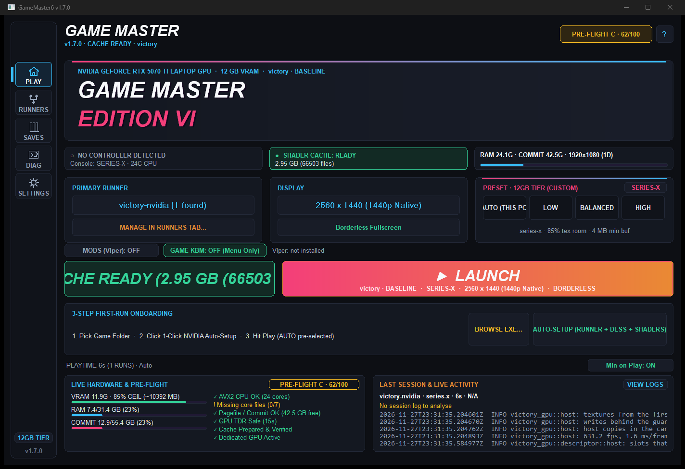

<div align="center">


# Game Master 6 — v1.7.0

**Native Windows launcher and NVIDIA RTX auto-tuner for Xbox Series compatibility runners.**

[](https://www.microsoft.com/windows)
[](https://www.nvidia.com/)
[](https://www.rust-lang.org/)
[](LICENSE)
[](https://github.com/<owner>/game-master-6/releases)

</div>



Game Master 6 is a small, native Rust + Win32 GDI Windows launcher for Xbox Series compatibility runners. It detects your GPU, applies a safe NVIDIA RTX preset, prepares the shader cache, launches the game, and can bridge the optional VIper mod framework — all without touching your original game files. Release builds are self-contained and **contain no game files or bundled third-party binaries** — bring your own game directory and runner. Licensed under **GPL-3.0**.

---

## Quick Start

1. **Download** the latest release ZIP from **Releases** and **extract** it to a clean folder.
2. **Run `GameMaster6.exe`** — no install and no extra dependencies.
3. Click **`AUTO (THIS PC)`**, then **`PREPARE CACHE`** once, then **`LAUNCH`**.

---

## `AUTO (THIS PC)` VRAM tiers

The launcher reads your dedicated VRAM and applies the matching baseline automatically:

| VRAM | Console | Res | DLSS | FG | Texture Room | Levels on Demand |
|---|---|---|---|---|---|---|
| 6 GB (<7.0) | Series-S | 1920x1080 | Performance | 2x | 60% | 1 |
| 8 GB (7.0-9.5) | Series-S | 1920x1080 | Performance | 2x | 68% | 1 |
| 10 GB (9.5-11.0) | Series-X | 2560x1440 | Performance | 2x | 80% | 0 |
| 12 GB+ (>=11.0) | Series-X | 2560x1440 | Balanced | 2x | 85% | 0 |

RTX 20 / 30 series cards use the `VICTORY_MENU_FPS`-independent `VICTORY_MENU_FG_TYPE=auto` Frame Generation fallback. RTX 50 series cards support selectable **3x Frame Generation**.

---

## The five tabs

- **PLAY** — hardware summary, `AUTO (THIS PC)`, `MODS (VIper)` and `GAME KBM` pills, cache preparation, and the launch control.
- **RUNNERS** — pick, add, build from source, or update a runner, plus the in-tab **VIper Mods** panel.
- **SAVES** — one-click save snapshots, restore, and quick benchmarks.
- **DIAG** — game-file checks, live runner logs, and a shareable debug bundle.
- **SETTINGS** — display, visuals, HUD, Frame Pacer, and advanced runner environment options.

### Save Manager

`EXPORT SAVES (.ZIP)` writes a timestamped snapshot to `backups\saves\` and never modifies your originals. Restore any snapshot in one click, and saves are backed up automatically before a runner update.

### 1-Click Updates

A non-blocking background check watches for launcher and runner updates, pauses while the game is running, and applies updates in one click — with saves backed up first.

---

## VIper Mods bridge

VIper is a static patcher: it links `mods\*.dll` into a modded **copy** of the game executable (`<game>.viper`). The original is never written. Game Master runs that copy through the same verified `victory.exe`, so DLSS, 2x Frame Generation and the 1440p preset stay intact.

- **`MODS (VIper): ON / OFF`** on PLAY — one click between vanilla and modded. A badge shows the installed version and active mod count.
- **Smart patch caching** — `<game>.viper` is only rebuilt when `viper.exe` or any `mods\*.dll` / `*.toml` changed. No patcher runs on an unchanged launch.
- **`RE-PATCH`** in RUNNERS → **VIper Mods** forces a re-link after changing mods.
- **1-Click Check & Update VIper** — non-blocking check of the upstream release, download/install into `runners\viper\`, previous version kept in `runners\viper\backup\` with a one-click **ROLLBACK**.
- **Per-mod toggles** — each `*.dll` in the active `mods\` folder can be enabled/disabled (renamed to `*.dll.disabled`) without deleting anything. **OPEN MODS FOLDER** opens the folder directly.
- A failed patch is reported with its exit code and full output in the status bar and `logs\viper-launch.log` — launching never fails silently.

---

## Frame Pacer

SETTINGS → Section 4 offers a smooth FPS cap tuned for 2x Frame Generation. It writes `VICTORY_MENU_FPS` and the verified pacer clock `VICTORY_FRAME_INTERVAL_US`:

| Selector | Menu FPS | Interval (us) | Presented with 2x FG |
|---|---|---|---|
| OFF (Uncapped) | 1000 | 1000 | uncapped |
| 24 FPS (48 FG Smooth) | 24 | 41667 | ~48 |
| 30 FPS (60 FG Smooth) | 30 | 33333 | ~60 |
| 36 FPS (72 FG) | 36 | 27778 | ~72 |

The 36 FPS preset exceeds a 60 Hz display's refresh when doubled; prefer 24 or 30 on 60 Hz panels.

---

## `GAME KBM: OFF (Menu Only)`

Controller-first input isolation for modded sessions (default **OFF** while `MODS (VIper): ON`):

- `VICTORY_MOUSE_CAPTURE=0` removes the mouse from the game entirely while leaving XInput pads untouched.
- `VICTORY_ONE_PAD=0` stops keyboard movement being merged into pad 0 while a real controller is connected.
- Set it to **ON** to restore normal keyboard + mouse gameplay.

The keyboard still reaches the game's own bindings; full keyboard suppression requires a runner change.

---

## Build from source

```powershell
git clone https://github.com/<owner>/game-master-6.git
cd game-master-6
cargo build --release
```

The binary is written to `target\release\GameMaster6.exe`.

---

## License

GPL-3.0 — see [LICENSE](LICENSE). This project contains no game files and does not bundle any compatibility runner or third-party binary.

<details>
<summary>Previous releases (v1.0-v1.6)</summary>

- **v1.6** — universal NVIDIA VRAM tiering, clean public runner feed, fresh-PC fixes and modern README.
- **v1.5** — one-click setup for runners, NVIDIA DLLs, and shader cache; process cleanup and diagnostics polish.
- **v1.4** — multi-runner manager, VRAM-tier presets, live telemetry, and save snapshots.
- **v1.0–v1.3** — initial releases: GDI launcher, runner profiles, and basic GPU-tier tuning.

</details>
