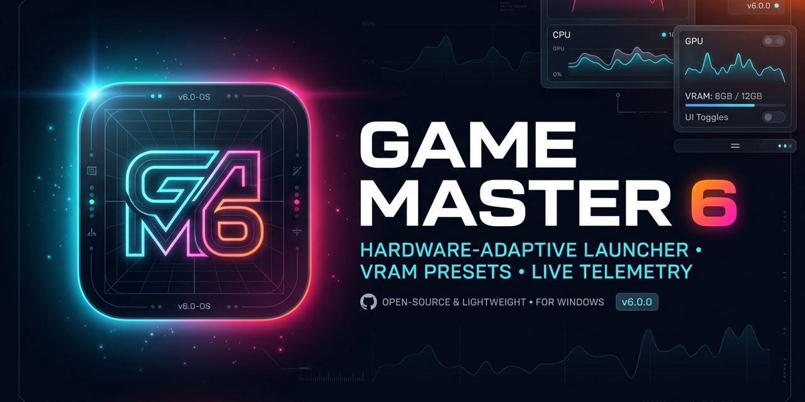

<div align="center">



# Game Master 6 (v1.5.1)

**A lightweight, zero-dependency Windows GUI launcher, hardware-adaptive VRAM preset manager, and live system telemetry frontend for `victory.exe` compatibility runners.**

[](https://github.com)
[](https://www.rust-lang.org/)
[](LICENSE)
[](GameMaster6-v1.5.1-Release.zip)

</div>

> **Disclaimer:** Game Master 6 is a pure frontend and configuration manager. It ships **without** any compatibility runners, third-party DLLs, or game files—users must supply their own title directory and `victory.exe` runner.

---

## What's New in v1.5.1

- **Zero "Not Responding" UI Freezes**: Suspended all background hardware, VRAM, process, PortWatch, shader census, and log polling while `victory.exe` is running (keeping only a lightweight 500 ms `try_wait()` check), switched cross-process borderless fullscreen `SetWindowPos` to `SWP_ASYNCWINDOWPOS`, and removed repeated cross-process `WM_SETTEXT` branding calls.
- **Clean XInput Controller Handoff**: Paused all launcher XInput polling and rumble tests while `victory.exe` is running so the game runner has exclusive controller access, and added an in-tab note clarifying that rumble strength/haptics are controlled by the game's Controls menu and runner HLE.
- **Anti-Whiteout Texture Streaming & Smoother DLSS Frame Pacing**: Wired live-benchmarked `VICTORY_SHOW_NEW_LATER=0`, `VICTORY_TEXTURE_CATCHUP=1`, `VICTORY_THIN=1`, `VICTORY_TEXTURE_ROOM_PERCENT=85` (12 GB tier, 0 VRAM errors) and steady `2x` DLSS Frame Generation across presets while keeping safe 6–8 GB ceilings (`70–74%`).
- **Mouse Capture / Hide Cursor Toggle**: Added `MOUSE CAPTURE / HIDE CURSOR` (`VICTORY_MOUSE_CAPTURE=1`) in Settings to keep the Windows cursor hidden and clipped during gameplay.
- **PortWatch Fallback Cleanup**: Removed dead/deleted repositories (`Belobug` and `AvatarManz`) from `FALLBACK_REPOS`, keeping `trustno1-coder/VIctory-NVIDIA` (#1 NVIDIA) and `DexNom/VIctory` (#1 AMD) at the top.

## What's New in v1.5.0

- **1-Click Triforce Auto-Setup**: Fresh installs lacking a runner, NVIDIA Streamline DLSS DLLs, or shader cache get a 1-click **AUTO-SETUP (RUNNER + DLSS + SHADERS)** flow on Play that auto-selects the best runner for your GPU (`VIctory-NVIDIA` for RTX; `DexNom` for AMD), fetches NVIDIA Streamline DLLs, warms shaders, and writes optimal GPU-tier `victory-settings.txt` (including safe 6 GB RTX 4050 defaults).
- **Live-Verified DLSS / MFG / Borderless / Uncapped FPS**: Streamline runners (`VIctory-NVIDIA`) automatically receive `VICTORY_ASYNC_SUBMIT=1` (keeping DLSS Frame Generation ON), `VICTORY_NATIVE_1440P=1` + `VICTORY_MENU_RES=1440` on <=16 GB GPUs, uncapped FPS (`VICTORY_MENU_FPS=1000`), native `VICTORY_FULLSCREEN=1` + 90s Win32 borderless fallback watcher, and all 4 fast F1 speed switches (`VICTORY_EARLY_DEPTH=1`, `VICTORY_WC_NO_BACK=1`, `VICTORY_SOFT_VIEWS=copies`, `VICTORY_LEAVE_OUT`) without VRAM-hogging overrides.
- **Zero Zombie Processes**: Every runner process tree is bound to a Windows Job Object (`JOB_OBJECT_LIMIT_KILL_ON_JOB_CLOSE`), backed by automatic pre-launch stray cleanup, a 4-second post-window-close headless watchdog, and a red **STOP GAME** button.
- **UI, Parser & Telemetry Polish**: Added **SECTION 0 · NVIDIA STREAMLINE & IN-GAME MENU** in Advanced (with `COOL_FOX` badges for fork-specific toggles), renamed `RESET DEFAULTS`, fixed `APPLY FIX` button clipping and Streamline-aware Auto-Doctor advice, fixed `GPU TIMING` log matching (excluding `timer_1ms`), added horizontal log line wrapping and `victory-nvidia-*.log` support, fixed shader census `SCANNING...` lockup, fixed Tools column truncation, updated `Kelvaroq` to `stellarr-studio/kelvaroq`, and enabled live tracker sync (`OFFLINE: OFF`) by default.

---

## Hardware-Adaptive VRAM Tiers

Game Master 6 probes your GPU's dedicated VRAM on first launch and applies a safe baseline (`VICTORY_RELAY=2`, `VICTORY_CARD_STEPS=2`, `VICTORY_HOST_WAVE=32` on NVIDIA, `VICTORY_LOG=warn`, Ray Tracing OFF):

| VRAM Tier | Example GPUs | Console / Output | `TEXTURE_ROOM_PERCENT` | `CARD_ROOM_FOR_TARGETS_MB` | `CARD_BUFFERS_MB` / `MIN_MB` | Notes |
|---|---|---|---|---|---|---|
| **6 GB (`Tight6`)** | RTX 4050 6 GB, RTX 3050, RTX 2060 | `series-s` / `1280x720` | `78%` | `1024` | `384` / `4` | Aggressive idle trim (`3s` / `64 MB`) keeping ~400 MB VRAM headroom for 2x DLSS FG or Lossless Scaling (`LSFG`) |
| **8 GB (`Tight8`)** | RTX 4060, RTX 3060 Ti / 3070 | `series-s` / `1280x720` | `85%` | `1536` | `512` / `4` | `VICTORY_THIN=0` on `LOW` |
| **12 GB (`Mid12`)** | RTX 5070 Ti 12 GB, RTX 4070, RTX 3060 12 GB | `series-x` or `series-s` / `1920x1080` | `80%` (with DLSS FG) / `90–94%` | `2048–2560` | `1024` / `4` | 1-click `SERIES-S` / `SERIES-X` toggle |
| **16 GB (`High16`)** | RTX 4080, RTX 5080, RX 7800 XT | `series-x` / `1920x1080–2560x1440` | `94%` | `2560` | `1024–2048` / `4` | Full Series X fidelity |
| **20 GB+ (`Ultra20`)** | RTX 4090, RTX 5090, RX 7900 XTX | `series-x` / `auto` | `94%` | `2560–3072` | `1024–4096` / `4` | Uncapped headroom |

---

## Quick Start (Release ZIP)

1. Download **`GameMaster6-v1.4-Release.zip`** from **Releases** and extract it to a clean folder (e.g., `C:\Tools\GameMaster6\`).
2. Run **`GameMaster6.exe`** — it auto-detects your VRAM tier (`6 GB` / `8 GB` / `12 GB` / `16 GB+`).
3. On **PLAY**, click **BROWSE GAME FOLDER...** to select your title directory and executable.
4. Open **RUNNERS**:
   - Select an existing `victory.exe`, drop in a custom `runner-profile.json`, or click **BUILD FROM URL...** to clone and compile a runner from GitHub.
   - If the runner repo includes `scripts/get-nvidia-sdks.ps1`, click **GET DLSS** on the runner card to fetch official signed NVIDIA Streamline/DLSS DLLs.
   - Use **UPDATE** or **ROLLBACK** anytime on source-built runners.
5. Click **PREPARE CACHE** once (runs `shaders --jobs <N>` + `warm` automatically if supported), then click **LAUNCH TITLE**.

### In-Game DLSS & Frame Generation Controls (`F1` / `F3`)
When `sl.interposer.dll` / `nvngx_dlss.dll` are beside `victory.exe`, the runner card displays **`DLSS / FG READY (F1 MENU · F3 STATS)`**:
- Press **`F1`** in-game to open the DLSS / **2x–6x Frame Generation** / FPS cap overlay (arrow keys navigate/change, **Enter** confirms, `SAVE AND RESTART NOW` persists to `victory-settings.txt`).
- Press **`F3`** in-game to toggle the live FPS, frame time, Frame Gen output, draw count, RAM, and VRAM overlay.

---

## Building from Source

```powershell
git clone https://github.com/game-master-6/game-master-6.git
cd game-master-6
cargo test
cargo build --release
```

The compiled binary is output to `target\release\GameMaster6.exe`.
