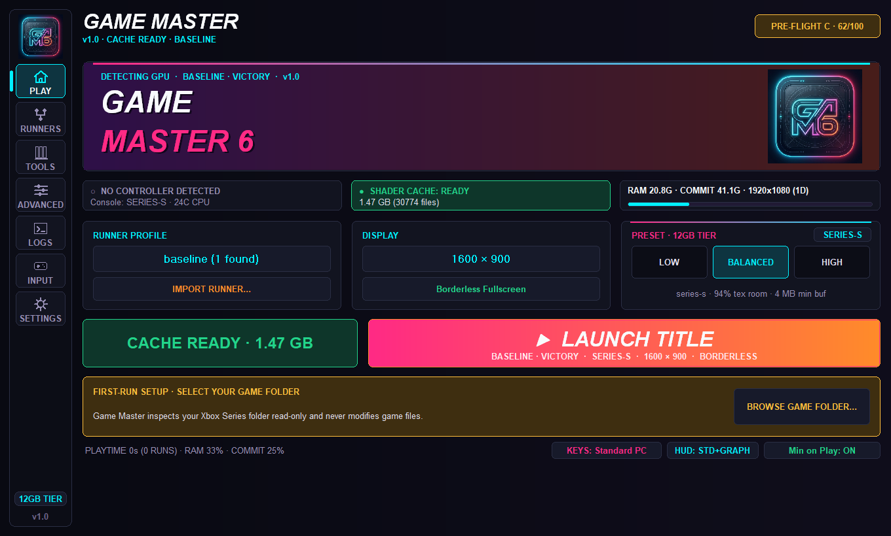
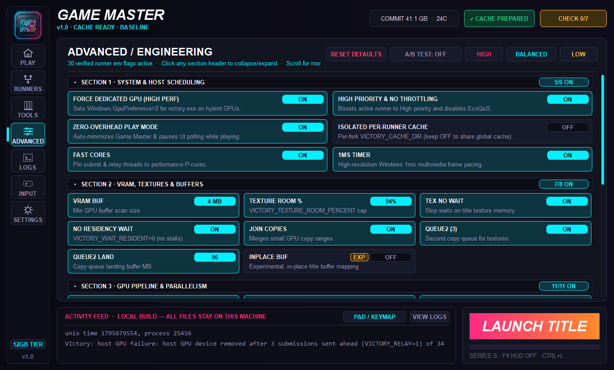

<div align="center">


# Game Master 6

**A lightweight, zero-dependency Windows GUI launcher, hardware-adaptive VRAM preset manager, and live system telemetry frontend for `victory.exe` compatibility runners.**

[](https://github.com)
[](https://www.rust-lang.org/)
[](LICENSE)
[](GameMaster6-v1.0-Release.zip)

</div>

> **Disclaimer:** Game Master 6 is a pure frontend and configuration manager. It ships **without** any compatibility runners, third-party DLLs, or game files—users must supply their own title directory and `victory.exe` runner.

---

## Preview

### Play Dashboard
Live hardware telemetry bars (VRAM ceiling, System RAM, Windows Commit/Pagefile), itemized Pre-Flight readiness score, dynamic process-aware System Tip, and last-session activity feed:



### Advanced Engineering Tab
5 collapsible sections with standardized status badges, per-knob descriptions, `VICTORY_TEXTURE_ROOM_PERCENT` selector, and clean vertical scrolling:



---

## Features

- **Hardware-Adaptive Presets (`LOW` / `BALANCED` / `HIGH`)**: Auto-detects GPU VRAM tier (`8 GB`, `12 GB`, `16 GB`, `24 GB+`) and CPU core count on first launch to configure safe `VICTORY_*` defaults.
- **1-Click Console Profile Toggle**: Switch between `SERIES-S` and `SERIES-X` directly from the Play tab Preset card for quick A/B testing.
- **Dynamic Process-Aware System Tip**: Monitors free RAM, Windows commit, top memory-consuming user apps, multi-monitor VRAM overhead, AC/battery power, and shader cache status.
- **Pre-Flight Readiness & Crash Guardian**: Scores system readiness (`0–100`), classifies known NVIDIA `wave32` runner notes separately from errors, and provides 1-click Last-Known-Good rollback.
- **Input, Keybinds & Session Telemetry**: Automatic FPS sparkline, runner head-to-head scorecard, log-synced session benchmark leaderboard, and shader translator census.
- **Zero External Dependencies**: Written in pure Rust (`std` + Win32/GDI/WinINet FFI) with sub-second incremental builds.

---

## Hardware-Adaptive VRAM Tiers

Game Master 6 probes your GPU's dedicated VRAM on first launch and applies a safe `BALANCED` baseline (all tiers keep `VICTORY_RELAY=2`, `VICTORY_CARD_STEPS=2`, and `VICTORY_LOG=warn`):

| VRAM Tier | Console Default | `BALANCED` Resolution | `TEXTURE_ROOM_PERCENT` | `CARD_ROOM_FOR_TARGETS_MB` | `CARD_BUFFERS_MB` / `MIN_MB` |
|---|---|---|---|---|---|
| **8 GB** | `series-s` | `1280x720` | `85%` | `1536` | `512` / `4` |
| **12 GB** | `series-s` (toggleable) | `1600x900` (`LOW`: `1280x720` @ `90%`) | `94%` | `2560` | `1024` / `4` |
| **16 GB+** | `series-x` | `1920x1080` | `94%` | `2560` | `1024` / `4` |

---

## Quick Start (Release ZIP)

1. Download **`GameMaster6-v1.0-Release.zip`** from the GitHub **Releases** tab and extract it to a clean folder (e.g., `C:\Tools\GameMaster6\`).
2. Run **`GameMaster6.exe`**.
3. On the **PLAY** tab, click **BROWSE GAME FOLDER...** to select your title directory and executable.
4. Open **RUNNERS** to select or import your `victory.exe` runner.
5. Choose **`LOW`**, **`BALANCED`**, or **`HIGH`** and **`SERIES-S` / `SERIES-X`**, click **PREPARE CACHE** once if supported, and press **LAUNCH TITLE**.

---

## Building from Source

### Prerequisites
- **Windows 10 / 11 (x86_64)**
- **Rust toolchain** via [rustup](https://rustup.rs/) (`stable-x86_64-pc-windows-msvc`)
- **Visual Studio Build Tools** (or Visual Studio) with the *Desktop development with C++* workload (Windows SDK + MSVC linker)

### Build & Test
```powershell
git clone https://github.com/divyeshganta/game-master-6.git
cd game-master-6
cargo test
cargo build --release
```

The compiled binary is output to `target\release\GameMaster6.exe`.

---

## Project Structure

```text
src/
├── main.rs          # Application entry point
├── ui.rs            # Win32 window loop, event/input handling, background worker polling
├── render.rs        # Custom Win32 GDI renderer for all tabs, cards, sparklines, and controls
├── win32.rs         # Raw Win32 FFI bindings (GDI, WinINet, Registry, XInput, Power/Process APIs)
├── config.rs        # Persistent settings loader/saver and option cyclers
├── presets.rs       # Hardware-adaptive VRAM-tier presets (8 GB, 12 GB, 16 GB, 24 GB+)
├── preflight.rs     # Live 0–100 hardware & system readiness scorer
├── launcher.rs      # Runner environment builder, process launcher, and shader census runner
├── runners.rs       # Local runner discovery, rollback, and cache directory management
├── builder.rs       # Automated runner build helper script generator
├── diagnostics.rs   # System probes, RAM/commit/process tips, log parsing, and debug bundles
├── telemetry.rs     # Log-synced session history, unified FPS parser, and A/B scorecard
├── ab_bench.rs      # A/B experiment flag definitions
├── guardian.rs      # Crash-recovery verdict engine and Last-Known-Good settings snapshot
├── hud.rs           # Click-through always-on-top performance HUD and center reticle overlay
├── keymap.rs        # Keyboard/mouse stand-in keymap presets and conflict checker
├── monitor.rs       # Live process RAM/commit usage sampler
├── portwatch.rs     # Community runner tracker client (WinINet JSON/HTML + offline fallback)
├── profiles.rs      # Portable profile import/export
├── saves.rs         # Save backup/restore and mod toggle helpers
├── shader_heal.rs   # Shader skip-list / healing helpers
└── vram_guard.rs    # Background VRAM-heavy process detector
```

---

## Contributing

Contributions are welcome! Please read [CONTRIBUTING.md](CONTRIBUTING.md) for the fork -> branch -> `cargo test` -> Pull Request workflow and repository hygiene rules.
